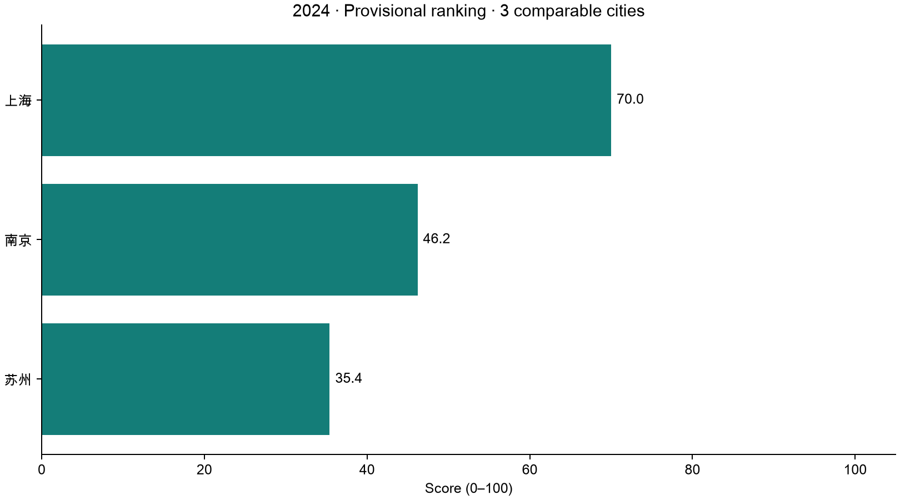
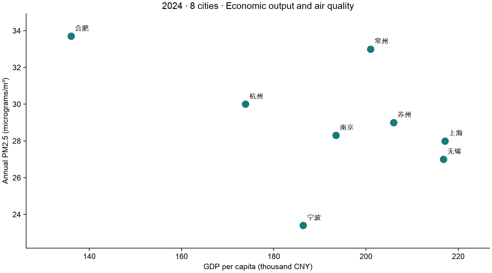

# CityInsight 2024 数据与偏好分析报告

> 本报告由 `scripts/create_analysis_report.py` 从实际输出生成。2024是数据年度，2026-10-10是来源复核日期。

## 数据覆盖

| 城市 | 有值原始指标 | 覆盖率 | 当前状态 |
|---|---:|---:|---|
| 上海 | 9/12 | 75.0% | 暂定排名 |
| 苏州 | 9/12 | 75.0% | 暂定排名 |
| 南京 | 9/12 | 75.0% | 暂定排名 |
| 杭州 | 6/12 | 50.0% | 数据不足，保留原值不排名 |
| 宁波 | 5/12 | 41.7% | 数据不足，保留原值不排名 |
| 无锡 | 7/12 | 58.3% | 数据不足，保留原值不排名 |
| 合肥 | 8/12 | 66.7% | 数据不足，保留原值不排名 |
| 常州 | 7/12 | 58.3% | 数据不足，保留原值不排名 |

共60条有值原始指标，其中57条核对了公开来源，3条为未复核的历史记录。派生房价收入比不计入原始指标覆盖率。

## 默认权重下的暂定结果

| 城市 | 经济机会 | 生活成本 | 公共服务 | 环境质量 | 总分 | 排名 |
|---|---:|---:|---:|---:|---:|---:|
| 上海 | 100.0 | 0.0 | 100.0 | 100.0 | 70.0 | 1 |
| 南京 | 18.6 | 80.2 | 38.1 | 53.6 | 46.2 | 2 |
| 苏州 | 15.5 | 100.0 | 0.0 | 0.0 | 35.4 | 3 |

这些分数仅比较四维数据达到门槛的同年城市。其余城市不共享完整生活成本指标，不应依据经济或空气数据强行给出综合名次。

## 同一数据，不同偏好

| 场景 | 权重（经济/成本/服务/环境） | 暂定排名（总分） |
|---|---|---|
| 默认 | 35/30/20/15% | 上海 70.0、南京 46.2、苏州 35.4 |
| 职业发展 | 55/20/15/10% | 上海 80.0、南京 37.4、苏州 28.5 |
| 成本优先 | 20/55/15/10% | 南京 58.9、苏州 58.1、上海 45.0 |
| 环境优先 | 20/20/20/40% | 上海 80.0、南京 48.8、苏州 23.1 |

这说明“最适合”取决于维度偏好。比较组及原始数据保持固定，只改变权重；当前生活成本还缺少租金，不能解释成总体生活支出比较。

## 权重敏感性

| 城市 | 最好排名 | 最差排名 | 第一名权重组合数（含并列） | 枚举总数 |
|---|---:|---:|---:|---:|
| 上海 | 1 | 3 | 226 | 286 |
| 南京 | 1 | 3 | 31 | 286 |
| 苏州 | 1 | 3 | 29 | 286 |

枚举每10个百分点一档、合计100%的四维权重，包含某维权重为0的端点。第一名组合数只是该离散网格下的探索结果，不代表城市宜居概率，也不是抽样统计的置信区间。

## 八城经济与空气原始值

横轴为人均GDP（千元/人），右侧表示人均经济产出更高；纵轴为年均PM2.5（μg/m³），下方表示颗粒物浓度更低。每个点是一座城市，图中使用原始值，不使用综合得分。经济产出不能替代个人工资或就业机会，监测范围也存在市区与全市差异。

## 已修正与统一的口径

- 上海人均GDP采用官方直接公布21.71万元换算元，替换原年末人口估算217424元；保留原发布精度。
- 南京人均GDP采用统计公报直接值193483元，替换年末人口估算193180元。
- 苏州非私营年工资统一为从业人员141827元（原143611是“在岗职工”）；南京统一为从业人员160374元（原165726是“在岗职工”）。派生房价收入比已重算。
- 八城普通高校均来自教育部截至2024-06-20同一份名单的所在地聚合，保存287所明细，避免跨城市混合普通高校、全部高校和年末公报口径。
- 无锡仅综合医院55、常州医院与卫生院合计157、宁波医院含妇保院225均不直接填入统一医院字段。

## 当前缺口与结论边界

- 五城缺少统一时点的住房指标；现有三城房价历史值尚未复核。租金、地铁站和公园存量全城待补。
- 杭州与宁波年工资还未读到可核实的官方正文，未使用转载数字补齐。
- 医院与高校未人口归一，住房指标存在重复影响；小样本Min-Max会放大差异。
- 当前结果支持流程验证与偏好探索，不支持完整八城宜居性结论。数据补齐会改变比较组与分数。

来源和复核方法见 [数据来源审计](data_source_audit_2024.md)，模型定义见 [指标体系](indicator_system.md)。
