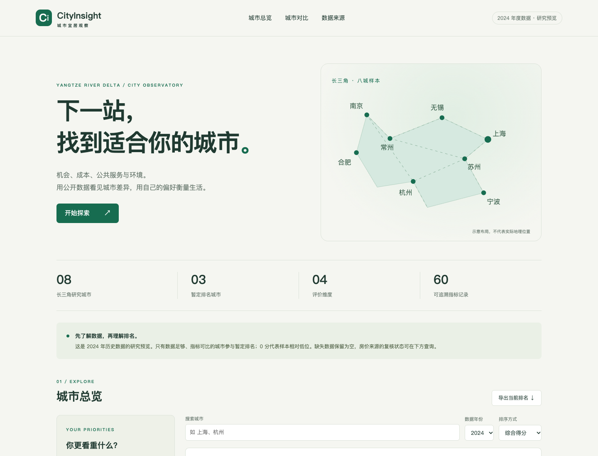

# CityInsight · 城市宜居观察

**用公开数据理解城市差异，用个人偏好探索适合自己的生活。**

A reproducible urban livability research project for eight Yangtze River Delta cities, with explainable scoring, source tracking, preference scenarios and an offline interactive dashboard.



## 现在可以做什么

- **城市总览**：搜索、排序、覆盖率、暂定得分与缺失状态。
- **个人偏好**：默认、职业发展、成本优先、环境优先四种预设；自由调整四维权重。
- **城市对比**：任意两城原始指标、可比城市四维画像；缺失值显示为空。
- **可追溯来源**：精确公开链接、统计口径与复核状态，按城市筛选。
- **可复现分析**：一键生成宽表、质量报告、评分、偏好分析、四类图表、交互数据及分析报告。
- **自动校验**：错误数据阻止流程；20项Python回归测试和浏览器操作检查。

## 数据范围与完成程度

数据所属年度为 **2024**；来源复核日期为 **2026-10-10**。

| 城市 | 原始指标有值数 / 12 | 当前综合排名状态 |
|---|---:|---|
| 上海 | 9 / 12 | 暂定 |
| 苏州 | 9 / 12 | 暂定 |
| 南京 | 9 / 12 | 暂定 |
| 杭州 | 6 / 12 | 生活成本待补 |
| 宁波 | 5 / 12 | 生活成本待补 |
| 无锡 | 7 / 12 | 生活成本待补 |
| 合肥 | 8 / 12 | 生活成本待补 |
| 常州 | 7 / 12 | 生活成本待补 |

共60条有值指标记录，57条已核对公开出处。所有城市已有GDP、第三产业、统一口径普通高校、PM2.5和空气优良比例；三城历史房价仍待复核。普通高校采用教育部**截至2024-06-20**名单，287所明细可复查。

**八城核心数据已经扩充，完整八城综合排名仍需要住房等数据。** 当前分数只用于小样本方法验证和偏好探索。住房缺口、监测范围和模型重复指标等局限见[来源审计](docs/data_source_audit_2024.md)与[指标体系](docs/indicator_system.md)。

## 立即查看看板

已有生成数据，打开 `dashboard/index.html` 即可离线使用，不需要安装Python依赖。也可在仓库根目录运行：

```bash
python -m http.server 8000 --directory dashboard --bind 127.0.0.1
```

浏览器打开 [本地看板](http://127.0.0.1:8000/)。页面使用本地CSS、JS和数据，无外部图表CDN依赖。

## 复现数据流程

建议Python **3.12**。以下命令从仓库根目录执行；脚本使用自身位置寻找数据，也支持其他工作目录。

```bash
python -m venv .venv
source .venv/bin/activate  # Windows: .venv\Scripts\activate
python -m pip install -r requirements.txt
python scripts/run_pipeline.py
```

流程遇到重复来源、非法数值、未知城市、错误单位、错误派生比值或宽表与来源表不一致会退出失败，不会继续生成新评分。

```text
来源表 + 城市表
  → 指标宽表（保留所有8城）
  → 校验及质量报告
  → 同年可比组评分与模型元数据
  → 4种偏好场景与286组权重敏感性
  → 图表 + 严格JSON/离线JS + 自动分析报告
```

各步骤可独立运行，文件均在 `scripts/`。修改数据应先编辑来源追踪表，再执行整条流程；直接修改生成宽表会在校验时失败。

### 自定义CLI权重

权重必须非负、有限、合计为1；使用单独输出文件保存不同情景。

```bash
python scripts/calculate_livability_scores.py \
  --weights '{"economy":0.20,"cost":0.55,"service":0.15,"environment":0.10}' \
  --output data/processed/custom_scores.csv
```

界面权重自动归一化；全零输入会被拒绝。CLI与浏览器默认评分及排名通过一致性检查。

## 方法与发现

| 维度 | 默认权重 | 方向 |
|---|---:|---|
| 经济机会 | 35% | 产出、单位工资、第三产业占比越高，分数越高 |
| 生活成本 | 30% | 价格、租金、房价收入比越低，分数越高 |
| 公共服务 | 20% | 医院、普通高校、地铁站数量越高，分数越高 |
| 环境质量 | 15% | PM2.5越低、优良比例及公园数量越高，分数越高 |

同年候选城市共享同一组有值指标，采用Min-Max归一化与维度内均值，再加权成总分。缺失值保留为空，常量有值指标为50。比较组不足两城或没有足够共同指标时不排名。0/100表示相对位置，不代表绝对宜居质量。

默认权重下，上海、南京、苏州暂定分为 **70.0、46.2、35.4**。成本优先会改变排序，见[自动生成的分析报告](docs/analysis_report_2024_mvp.md)。286组权重枚举用于观察名次敏感性，不是统计置信区间。


## 验证

```bash
python -m pip install -r requirements-dev.txt
python -m pytest -q
python -m playwright install chromium
python scripts/check_dashboard.py
```

已有Chrome时可复用本地浏览器，省略浏览器下载：

```bash
python scripts/check_dashboard.py --browser-path "/path/to/chrome"
```

浏览器检查覆盖权重预设及重置、Python/JS评分一致性、城市搜索、缺失城市对比、来源筛选、CSV下载、全零权重保护、390px手机布局及 `file://` 离线加载。脚本自动启停临时本地服务器。

GitHub Actions在push和PR上运行回归测试、完整流程、浏览器检查，并核对生成数据/报告可复现。PostgreSQL的SQL初始化设计已更新约束；实际数据库运行尚未验证。

## 仓库结构

```text
scripts/                 数据、评分、图表、报告与浏览器验证
  model.py               共享字段、校验、权重和评分规则
  run_pipeline.py        一键入口
  check_dashboard.py     浏览器操作验证
 data/raw/               来源追踪、城市基础、实际指标宽表
 data/reference/         教育部普通高校287所子集
 data/processed/         质量、得分、比较组、偏好与敏感性输出
 dashboard/              无依赖静态交互看板
  data/                  自动生成的JSON与离线JS
  figures/               自动生成的静态图表
 docs/                   定义、字典、模型、来源审计与报告
 tests/                  数学边界和数据完整性回归测试
 database/schema.sql     PostgreSQL初始化设计
 .github/workflows/      自动验证
```

早期 `city_indicators_2024.csv` 为六维设计模板，不参与当前实际流程。当前模型只有四维，城市活力与气候舒适度为后续规划。

## 下一阶段

1. 复核三城历史住房值，统一补齐五城同一月份/范围的房价、租金。
2. 完善医院、地铁与公园存量口径，加入人口及人均公共服务。
3. 完整八城数据达到共同指标门槛后重算；比较独立成本指标、基准区间与不同权重方法。
4. 根据实际需求接入API、数据库导入和在线部署。

数据和个人偏好共同决定结果。年均单位税前工资不是个人收入预测，城市评分也不是通用择城答案。
