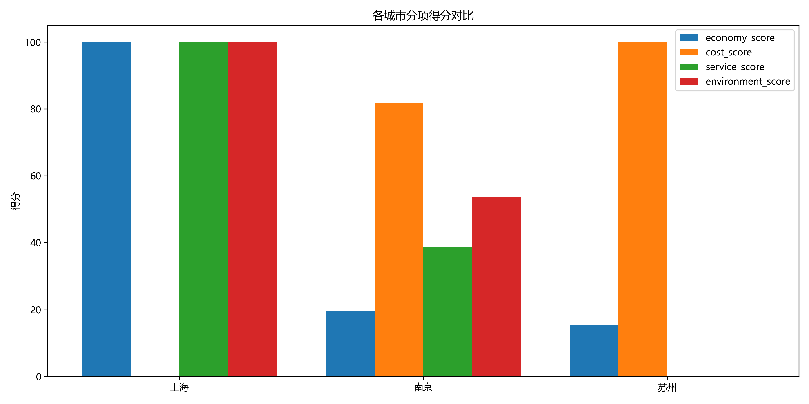
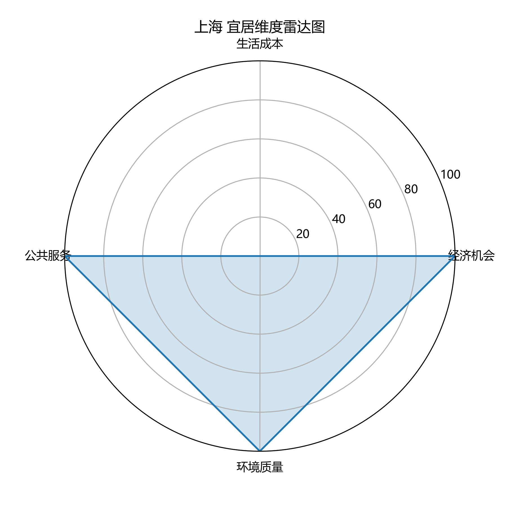

# CityInsight: Urban Livability Index Analytics Platform

# CityInsight：中国城市宜居指数分析平台

CityInsight is an end-to-end urban data analytics project designed to evaluate and compare city livability using multi-dimensional public data.

CityInsight 是一个端到端城市数据分析项目，旨在通过多维公开数据构建城市宜居评价体系，用于分析和比较不同城市的综合宜居水平。

The project focuses on young people, graduates, and early-career professionals who need to make decisions about where to work, live, and develop in the long term.

本项目主要面向年轻人、应届毕业生和职场新人，帮助他们在就业、生活和长期发展城市选择中获得更直观的数据参考。

The project is currently under active development. At the current stage, the core data pipeline, scoring logic, visualization scripts, documentation, and GitHub repository have been completed. Shanghai, Suzhou, and Nanjing are used as the initial pilot cities, and the next step is to expand the dataset to eight representative cities in the Yangtze River Delta region.

当前项目仍在持续开发中。目前已经完成核心数据流程、评分逻辑、可视化脚本、项目文档和 GitHub 仓库发布。当前使用上海、苏州、南京作为初始测试城市，下一阶段将扩展至长三角 8 个代表性城市。

---

## Table of Contents

## 目录

* [1. Project Overview 项目概述](#1-project-overview-项目概述)
* [2. Project Motivation 项目动机](#2-project-motivation-项目动机)
* [3. Current Progress 当前进度](#3-current-progress-当前进度)
* [4. Target Cities 目标城市](#4-target-cities-目标城市)
* [5. Indicator System 指标体系](#5-indicator-system-指标体系)
* [6. Core Indicators 核心指标](#6-core-indicators-核心指标)
* [7. Data Pipeline 数据处理流程](#7-data-pipeline-数据处理流程)
* [8. Scoring Methodology 评分方法](#8-scoring-methodology-评分方法)
* [9. Current Results 当前结果](#9-current-results-当前结果)
* [10. Visualizations 可视化结果](#10-visualizations-可视化结果)
* [11. Preliminary Findings 初步发现](#11-preliminary-findings-初步发现)
* [12. Project Structure 项目结构](#12-project-structure-项目结构)
* [13. Tech Stack 技术栈](#13-tech-stack-技术栈)
* [14. How to Run 运行方式](#14-how-to-run-运行方式)
* [15. Data Management 数据管理](#15-data-management-数据管理)
* [16. Documentation 项目文档](#16-documentation-项目文档)
* [17. Limitations 当前局限](#17-limitations-当前局限)
* [18. Roadmap 后续计划](#18-roadmap-后续计划)
* [19. Project Value 项目价值](#19-project-value-项目价值)
* [20. Disclaimer 免责声明](#20-disclaimer-免责声明)

---

## 1. Project Overview 项目概述

CityInsight aims to build a reproducible and explainable urban livability index based on city-level public data.

CityInsight 的目标是基于城市层面的公开数据，构建一个可复现、可解释、可扩展的城市宜居指数。

The current version evaluates cities from four major dimensions:

当前版本从以下 4 个主要维度评价城市：

1. Economic Opportunity
   经济机会

2. Living Cost
   生活成本

3. Public Services
   公共服务

4. Environmental Quality
   环境质量

The project is not limited to a single notebook or a static chart. It includes data source tracking, indicator table generation, data quality checking, score calculation, visualization, database schema design, and project documentation.

本项目不是单一 Notebook 或静态图表，而是包含数据来源追踪、指标表生成、数据质量检查、得分计算、可视化、数据库结构设计和项目文档的完整数据分析流程。

---

## 2. Project Motivation 项目动机

Choosing a city for work and long-term life is a multi-dimensional decision. A city with strong economic opportunities may also have high housing pressure. A city with lower living costs may have fewer job opportunities or weaker public service resources.

选择一个城市工作和长期生活是一个多维决策。经济机会强的城市往往也伴随着较高的住房压力；生活成本较低的城市可能在就业机会或公共服务资源方面相对较弱。

This project tries to answer the following questions:

本项目希望回答以下问题：

1. Which cities are more livable under a multi-dimensional evaluation framework?
   在多维评价体系下，哪些城市的综合宜居程度更高？

2. What are the strengths and weaknesses of each city?
   不同城市分别有哪些优势和短板？

3. How do economic opportunity, housing pressure, public services, and environmental quality interact?
   经济机会、住房压力、公共服务和环境质量之间如何共同影响城市宜居性？

4. Can an explainable and reproducible livability index be built from public data?
   能否基于公开数据构建一个可解释、可复现的城市宜居指数？

5. Can this project be further developed into an interactive dashboard or web-based decision-support platform?
   该项目能否进一步扩展为交互式数据看板或 Web 决策支持平台？

---

## 3. Current Progress 当前进度

The project is currently in the prototype and MVP implementation stage.

当前项目处于原型开发和 MVP 实现阶段。

### Completed 已完成

* Project definition and scope design
  项目定义与范围设计

* Initial indicator system design
  初始指标体系设计

* City basic information table
  城市基础信息表

* Data source tracking table
  数据来源追踪表

* MVP indicator table generation script
  MVP 指标表生成脚本

* Data quality checking script
  数据质量检查脚本

* Automatic house-price-to-income ratio calculation
  房价收入比自动计算

* Livability score calculation script
  宜居指数计算脚本

* Basic visualization generation script
  基础可视化图表生成脚本

* MVP analysis report
  MVP 分析报告

* PostgreSQL schema design
  PostgreSQL 数据库结构设计

* Git version control
  Git 版本管理

* GitHub repository setup
  GitHub 仓库发布

### Current Data Coverage 当前数据覆盖

The current working dataset includes pilot data for:

当前工作数据集已初步整理以下城市：

* Shanghai
  上海

* Suzhou
  苏州

* Nanjing
  南京

The current result should be interpreted as a workflow validation result, not as the final city ranking.

当前结果应被理解为流程验证结果，而不是最终城市排名结论。

### Next Milestone 下一阶段目标

The next milestone is to expand the dataset from the current 3-city pilot version to the planned 8-city Yangtze River Delta version.

下一阶段目标是将当前 3 城测试版扩展为长三角 8 城版本。

---

## 4. Target Cities 目标城市

The planned city scope includes eight representative cities in the Yangtze River Delta region.

计划中的城市范围包括长三角地区 8 个代表性城市。

| city_id | City      | 城市 | Province / Municipality | 省份 / 直辖市 | Current Status 当前状态          |
| ------: | --------- | -- | ----------------------- | -------- | ---------------------------- |
|       1 | Shanghai  | 上海 | Shanghai                | 上海       | Initial data completed 已初步整理 |
|       2 | Suzhou    | 苏州 | Jiangsu                 | 江苏       | Initial data completed 已初步整理 |
|       3 | Nanjing   | 南京 | Jiangsu                 | 江苏       | Initial data completed 已初步整理 |
|       4 | Hangzhou  | 杭州 | Zhejiang                | 浙江       | To be added 待补充              |
|       5 | Ningbo    | 宁波 | Zhejiang                | 浙江       | To be added 待补充              |
|       6 | Wuxi      | 无锡 | Jiangsu                 | 江苏       | To be added 待补充              |
|       7 | Hefei     | 合肥 | Anhui                   | 安徽       | To be added 待补充              |
|       8 | Changzhou | 常州 | Jiangsu                 | 江苏       | To be added 待补充              |

Future versions may extend the project to more Chinese cities.

后续版本可继续扩展至更多中国城市。

---

## 5. Indicator System 指标体系

The current version uses four first-level dimensions.

当前版本采用 4 个一级维度。

| Dimension             | 一级维度 | Weight 权重 | Example Indicators 示例指标                                                    | Direction 指标方向 |
| --------------------- | ---- | --------: | -------------------------------------------------------------------------- | -------------- |
| Economic Opportunity  | 经济机会 |       35% | GDP per capita, average salary, tertiary industry ratio 人均 GDP、平均工资、第三产业占比 | Positive 正向    |
| Living Cost           | 生活成本 |       30% | Housing price, rent, house-price-to-income ratio 房价、租金、房价收入比               | Negative 负向    |
| Public Services       | 公共服务 |       20% | Hospitals, universities, metro stations 医院数量、高校数量、地铁站数量                    | Positive 正向    |
| Environmental Quality | 环境质量 |       15% | PM2.5, good air days ratio, parks PM2.5、空气优良天数比例、公园数量                      | Mixed 混合       |

The original long-term plan includes six dimensions by adding Urban Vitality and Climate Comfort.

项目长期规划中还包括城市活力和气候舒适度两个维度。

These two dimensions are not included in the current scoring model because the required data has not yet been fully collected.

由于相关数据尚未完整整理，当前评分模型暂未纳入这两个维度。

---

## 6. Core Indicators 核心指标

### 6.1 Economic Opportunity 经济机会

| Field 字段名                 | Description 含义                                                       | Direction 指标方向 |
| ------------------------- | -------------------------------------------------------------------- | -------------- |
| `gdp_per_capita`          | GDP per capita 人均 GDP                                                | Positive 正向    |
| `avg_salary_non_private`  | Average salary of urban non-private sector employees 城镇非私营单位就业人员平均工资 | Positive 正向    |
| `avg_salary_private`      | Average salary of urban private sector employees 城镇私营单位就业人员平均工资      | Positive 正向    |
| `tertiary_industry_ratio` | Share of tertiary industry in GDP 第三产业增加值占 GDP 比重                    | Positive 正向    |

The salary indicators are separated into non-private and private sector salaries to avoid mixing different statistical definitions into one ambiguous average salary field.

工资指标被拆分为非私营单位平均工资和私营单位平均工资，以避免将不同统计口径混合成一个模糊的平均工资字段。

---

### 6.2 Living Cost 生活成本

| Field 字段名                              | Description 含义                                                                 | Direction 指标方向 |
| -------------------------------------- | ------------------------------------------------------------------------------ | -------------- |
| `house_price`                          | Average housing price 平均房价                                                     | Negative 负向    |
| `avg_rent`                             | Average rent 平均租金                                                              | Negative 负向    |
| `house_price_income_ratio_non_private` | House-price-to-income ratio based on non-private sector salary 基于非私营单位工资的房价收入比 | Negative 负向    |
| `house_price_income_ratio_private`     | House-price-to-income ratio based on private sector salary 基于私营单位工资的房价收入比      | Negative 负向    |

The house-price-to-income ratio is calculated as:

房价收入比计算公式如下：

```text
house_price_income_ratio = house_price × 90 / annual_salary
```

其中，`90` 表示标准 90 平方米住房面积。

Two versions are calculated:

项目分别计算两个版本：

```text
house_price_income_ratio_non_private = house_price × 90 / avg_salary_non_private
house_price_income_ratio_private = house_price × 90 / avg_salary_private
```

The calculated results are rounded to one decimal place.

计算结果保留一位小数。

---

### 6.3 Public Services 公共服务

| Field 字段名             | Description 含义                                            | Direction 指标方向 |
| --------------------- | --------------------------------------------------------- | -------------- |
| `hospital_count`      | Number of hospitals 医院数量                                  | Positive 正向    |
| `university_count`    | Number of ordinary higher education institutions 普通高等学校数量 | Positive 正向    |
| `metro_station_count` | Number of metro stations 地铁站数量                            | Positive 正向    |

The current version uses absolute counts. Future versions will normalize these indicators by population, such as hospitals per million residents.

当前版本暂时使用绝对数量。后续版本将考虑按人口规模进行归一化，例如每百万人医院数量。

---

### 6.4 Environmental Quality 环境质量

| Field 字段名             | Description 含义                                 | Direction 指标方向 |
| --------------------- | ---------------------------------------------- | -------------- |
| `pm25`                | Annual average PM2.5 concentration PM2.5 年均浓度  | Negative 负向    |
| `good_air_days_ratio` | Ratio of days with good air quality 空气质量优良天数比例 | Positive 正向    |
| `park_count`          | Number of parks 公园数量                           | Positive 正向    |

The project currently uses `good_air_days_ratio`, which refers to the ratio of days with good air quality. It does not use AQI as a standalone scoring indicator in the current version.

当前项目使用的是 `good_air_days_ratio`，即空气质量优良天数比例。当前版本并未将 AQI 作为独立评分指标。

---

## 7. Data Pipeline 数据处理流程

The current data pipeline is:

当前数据处理流程如下：

```text
data/raw/data_source_tracking_2024.csv
        ↓
scripts/build_mvp_indicator_table.py
        ↓
data/raw/city_indicators_2024_mvp.csv
        ↓
scripts/check_mvp_data.py
        ↓
scripts/calculate_livability_scores.py
        ↓
data/processed/livability_scores_2024.csv
        ↓
scripts/create_basic_charts.py
        ↓
dashboard/figures
```

### Pipeline Components 流程组件

| File / Script 文件 / 脚本                       | Purpose 作用                                                                                                   |
| ------------------------------------------- | ------------------------------------------------------------------------------------------------------------ |
| `data/raw/data_source_tracking_2024.csv`    | Tracks original data values, units, sources, and notes 追踪原始数据、单位、来源和备注                                       |
| `scripts/build_mvp_indicator_table.py`      | Converts the source tracking table into a wide indicator table 将来源追踪表转换为指标宽表                                 |
| `data/raw/city_indicators_2024_mvp.csv`     | Main city-indicator table used for scoring 用于评分的城市指标表                                                        |
| `scripts/check_mvp_data.py`                 | Checks missing values, duplicated rows, city matching, data types, and value ranges 检查缺失值、重复行、城市匹配、字段类型和数值范围 |
| `scripts/calculate_livability_scores.py`    | Normalizes indicators and calculates dimension scores and total scores 标准化指标并计算分项得分和总分                       |
| `data/processed/livability_scores_2024.csv` | Final score and ranking output 最终得分和排名输出                                                                     |
| `scripts/create_basic_charts.py`            | Generates charts and saves them to `dashboard/figures` 生成图表并保存至 `dashboard/figures`                          |

This design keeps source data, processed indicators, and final results separated, making the project easier to reproduce, audit, and extend.

这种设计将来源数据、处理后指标和最终结果分离，使项目更容易复现、检查和扩展。

---

## 8. Scoring Methodology 评分方法

### 8.1 Min-Max Normalization 最小-最大标准化

Since different indicators use different units, all indicators are normalized to a 0–100 score.

由于不同指标的量纲不同，项目将所有指标标准化为 0–100 分。

For positive indicators, where higher values are better:

对于数值越高越好的正向指标：

```text
score = (x - min) / (max - min) × 100
```

For negative indicators, where lower values are better:

对于数值越低越好的负向指标：

```text
score = (max - x) / (max - min) × 100
```

If all cities have the same value for an indicator, the score is set to 50 to avoid division by zero.

如果某个指标所有城市数值相同，则该指标得分设为 50，以避免除零错误。

---

### 8.2 Dimension Scores 分项得分

Each first-level dimension score is calculated by averaging the available normalized indicator scores within that dimension.

每个一级维度得分由该维度下可用指标的标准化得分取平均得到。

Missing values are ignored during row-wise averaging, allowing the pipeline to run even when some indicators are not yet fully collected.

在逐行计算平均值时会忽略缺失值，因此即使部分指标尚未补齐，流程也可以继续运行。

---

### 8.3 Total Livability Score 综合宜居得分

The current total score is calculated as:

当前综合得分计算公式如下：

```text
total_score =
economy_score × 0.35
+ cost_score × 0.30
+ service_score × 0.20
+ environment_score × 0.15
```

The current weights are manually assigned based on the assumption that young people usually care strongly about economic opportunities and living costs.

当前权重为人工设定，主要基于年轻人在择城时通常较重视经济机会和生活成本这一假设。

Future versions may explore AHP, entropy weighting, or user-defined weights.

后续版本可以尝试使用 AHP 层次分析法、熵权法或用户自定义权重。

---

## 9. Current Results 当前结果

The current processed result file is:

当前处理后的结果文件为：

```text
data/processed/livability_scores_2024.csv
```

It contains the following main fields:

该文件包含以下主要字段：

| Field 字段名           | Description 含义                       |
| ------------------- | ------------------------------------ |
| `city_id`           | City ID 城市 ID                        |
| `city_name`         | City name 城市名称                       |
| `year`              | Data year 数据年份                       |
| `economy_score`     | Economic opportunity score 经济机会得分    |
| `cost_score`        | Living cost score 生活成本得分             |
| `service_score`     | Public service score 公共服务得分          |
| `environment_score` | Environmental quality score 环境质量得分   |
| `total_score`       | Overall livability score 综合宜居得分      |
| `rank`              | Ranking based on total score 基于总分的排名 |

The current output is based on available data for Shanghai, Suzhou, and Nanjing. The ranking should be treated as a preliminary workflow test rather than a final conclusion.

当前输出基于上海、苏州、南京三城已有数据。该排名应被视为初步流程测试结果，而不是最终结论。

---

## 10. Visualizations 可视化结果

Generated charts are saved in:

生成的图表保存在：

```text
dashboard/figures
```

### 10.1 Livability Score Ranking 宜居指数排名


---

### 10.2 Dimension Score Comparison 分项得分对比



---

### 10.3 City Radar Chart 城市雷达图



---

## 11. Preliminary Findings 初步发现

Based on the current 3-city pilot dataset:

基于当前 3 城测试数据，可以得到以下初步发现：

1. Shanghai performs strongly in economic opportunity, public services, and environmental quality.
   上海在经济机会、公共服务和环境质量方面表现较强。

2. Shanghai receives a lower living cost score due to high housing prices.
   由于房价较高，上海在生活成本维度得分较低。

3. Suzhou shows relative advantages in living cost.
   苏州在生活成本方面具有相对优势。

4. Nanjing appears more balanced across multiple dimensions.
   南京在多个维度上表现相对均衡。

5. Livability is not determined by economic strength alone; it depends on the balance between income opportunities, housing pressure, public services, and environmental conditions.
   城市宜居性并不只由经济实力决定，而是由收入机会、住房压力、公共服务和环境条件之间的平衡共同决定。

These findings are preliminary and will be updated after the full 8-city dataset is completed.

以上发现仍为初步结果，将在长三角 8 城数据补齐后继续更新。

---

## 12. Project Structure 项目结构

```text
CityInsight

├── data
│   ├── raw
│   │   ├── city_basic.csv
│   │   ├── city_indicators_2024.csv
│   │   ├── city_indicators_2024_mvp.csv
│   │   └── data_source_tracking_2024.csv
│   │
│   └── processed
│       └── livability_scores_2024.csv
│
├── database
│   └── schema.sql
│
├── dashboard
│   └── figures
│       ├── 01_total_score_ranking.png
│       ├── 02_dimension_scores.png
│       └── 03_radar_上海.png
│
├── docs
│   ├── project_definition.md
│   ├── indicator_system.md
│   ├── data_dictionary.md
│   └── analysis_report_2024_mvp.md
│
├── scripts
│   ├── build_mvp_indicator_table.py
│   ├── check_mvp_data.py
│   ├── calculate_livability_scores.py
│   └── create_basic_charts.py
│
├── .gitignore
├── requirements.txt
└── README.md
```

---

## 13. Tech Stack 技术栈

### Currently Used 当前已使用

* Python

* Pandas

* NumPy

* Matplotlib

* PostgreSQL schema design
  PostgreSQL 数据库结构设计

* Git

* GitHub

### Planned 后续计划使用

* PostgreSQL database integration
  PostgreSQL 数据库集成

* FastAPI backend
  FastAPI 后端接口

* Vue frontend
  Vue 前端页面

* ECharts interactive visualization
  ECharts 交互式可视化

* City comparison page
  城市对比页面

* Personalized city recommendation module
  个性化城市推荐模块

---

## 14. How to Run 运行方式

### 14.1 Install Dependencies 安装依赖

```bash
pip install -r requirements.txt
```

---

### 14.2 Generate the Indicator Table 生成指标表

```bash
python scripts/build_mvp_indicator_table.py
```

This script reads:

该脚本读取：

```text
data/raw/data_source_tracking_2024.csv
```

and generates:

并生成：

```text
data/raw/city_indicators_2024_mvp.csv
```

It also calculates:

同时自动计算：

```text
house_price_income_ratio_non_private
house_price_income_ratio_private
```

---

### 14.3 Check Data Quality 检查数据质量

```bash
python scripts/check_mvp_data.py
```

This script checks:

该脚本用于检查：

* City ID matching
  城市 ID 是否匹配

* Missing values
  缺失值

* Duplicate rows
  重复行

* Data types
  字段类型

* Simple value ranges
  基础数值范围

---

### 14.4 Calculate Livability Scores 计算宜居指数

```bash
python scripts/calculate_livability_scores.py
```

This generates:

该脚本生成：

```text
data/processed/livability_scores_2024.csv
```

---

### 14.5 Generate Visualizations 生成可视化图表

```bash
python scripts/create_basic_charts.py
```

Generated charts are saved in:

生成的图表保存至：

```text
dashboard/figures
```

---

## 15. Data Management 数据管理

The project separates data into three levels.

项目将数据分为三个层级管理。

### 15.1 Source Tracking Data 来源追踪数据

```text
data/raw/data_source_tracking_2024.csv
```

This file records:

该文件记录：

* Indicator name
  指标名称

* Category
  指标类别

* City
  城市

* Year
  年份

* Value
  数值

* Unit
  单位

* Source name
  来源名称

* Source URL
  来源链接

* Source type
  来源类型

* Notes
  备注

This is the main table that should be manually maintained.

这是当前项目中主要需要手动维护的数据表。

---

### 15.2 Indicator Table 指标表

```text
data/raw/city_indicators_2024_mvp.csv
```

This table is automatically generated from the source tracking table.

该表由来源追踪表自动生成。

It should not be manually edited unless necessary.

除非必要，不建议手动修改该表。

---

### 15.3 Score Output 得分输出表

```text
data/processed/livability_scores_2024.csv
```

This file is automatically generated by the scoring script.

该文件由评分脚本自动生成。

---

## 16. Documentation 项目文档

Additional documentation is available in the `docs` folder.

更多项目文档位于 `docs` 文件夹。

| File 文件                            | Description 说明                                           |
| ---------------------------------- | -------------------------------------------------------- |
| `docs/project_definition.md`       | Project definition, target users, and scope 项目定义、目标用户和范围 |
| `docs/indicator_system.md`         | Indicator system design 指标体系设计                           |
| `docs/data_dictionary.md`          | Field definitions and indicator directions 字段定义和指标方向     |
| `docs/analysis_report_2024_mvp.md` | MVP analysis report MVP 分析报告                             |

---

## 17. Limitations 当前局限

The current version has the following limitations:

当前版本仍存在以下局限：

1. Only three cities have been initially processed.
   目前只完成了三个城市的初步数据整理。

2. The full eight-city Yangtze River Delta dataset is not yet complete.
   长三角 8 城数据尚未完全补齐。

3. Some indicators are still missing, such as rent, metro station count, and park count.
   部分指标仍缺失，例如租金、地铁站数量、公园数量等。

4. Public service indicators currently use absolute counts rather than per-capita values.
   公共服务指标当前使用绝对数量，尚未按人口规模归一化。

5. Housing price data comes from third-party platforms and may differ from official transaction statistics.
   房价数据来自第三方平台，可能与官方交易统计口径存在差异。

6. Min-Max normalization may produce extreme 0 and 100 scores when the sample size is small.
   在样本城市较少时，Min-Max 标准化容易产生 0 分和 100 分的极端值。

7. Current weights are manually assigned and may need further refinement.
   当前权重为人工设定，后续仍需进一步优化。

---

## 18. Roadmap 后续计划

### Short-Term 短期计划

* Add Hangzhou, Ningbo, Wuxi, Hefei, and Changzhou data
  补充杭州、宁波、无锡、合肥、常州数据

* Complete the full eight-city Yangtze River Delta dataset
  完成长三角 8 城数据集

* Update ranking and visualization results
  更新排名和可视化结果

* Improve analysis report
  优化分析报告

* Add more comparison charts
  增加更多对比图表

---

### Medium-Term 中期计划

* Add rent, metro station count, park count, and population indicators
  增加租金、地铁站数量、公园数量和人口指标

* Normalize public service indicators by population
  将公共服务指标按人口规模归一化

* Add urban vitality and climate comfort dimensions
  增加城市活力和气候舒适度维度

* Improve weighting methodology
  优化权重方法

* Add K-Means clustering for city type classification
  增加 K-Means 聚类，用于城市类型划分

---

### Long-Term 长期计划

* Build a FastAPI backend
  开发 FastAPI 后端

* Build a Vue + ECharts frontend
  开发 Vue + ECharts 前端

* Add interactive city comparison
  增加交互式城市对比

* Add personalized city recommendation
  增加个性化城市推荐

* Extend the dataset to more Chinese cities
  将数据扩展至更多中国城市

* Deploy a public web demo
  部署公开 Web Demo

---

## 19. Project Value 项目价值

This project is designed as a complete data analytics portfolio project rather than a simple notebook or course assignment.

本项目被设计为一个完整的数据分析作品集项目，而不是简单的 Notebook 或课程作业。

It demonstrates:

它体现了以下能力：

* Data source management
  数据来源管理

* Data cleaning and transformation
  数据清洗与转换

* Indicator system design
  指标体系设计

* Derived feature calculation
  衍生指标计算

* Data quality checking
  数据质量检查

* Scoring model construction
  评分模型构建

* Data visualization
  数据可视化

* Technical documentation
  技术文档撰写

* Git and GitHub project management
  Git 与 GitHub 项目管理

* Potential full-stack analytics platform development
  潜在的全栈数据分析平台开发能力

The current version has already validated the end-to-end workflow. Future versions will focus on expanding data coverage, improving scoring methodology, and building interactive system features.

当前版本已经验证了端到端数据分析流程。后续版本将重点扩展数据覆盖范围、优化评分方法，并逐步构建交互式系统功能。

---

## 20. Disclaimer 免责声明

The current results are preliminary and are based on partial data coverage.

当前结果为初步结果，且基于部分数据覆盖。

They should not be interpreted as an official or final ranking of city livability.

这些结果不应被理解为官方或最终城市宜居排名。

The project is for learning, portfolio building, and exploratory data analysis purposes.

本项目主要用于学习、作品集建设和探索性数据分析。
